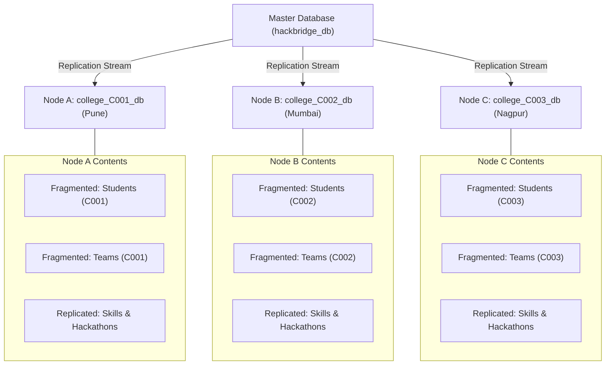

# HackBridge — Distributed Database Management System (DDBMS) Architecture

This document specifies the distributed database architecture implemented in HackBridge to meet the academic and systems engineering requirements.

---

## 1. Architectural Overview

In a multi-college innovation network, individual colleges maintain administrative autonomy over their local student rosters, project submissions, and internal team formations. Simultaneously, the platform requires seamless inter-college collaboration, universal hackathon discovery, and global search.

HackBridge simulates a distributed database environment consisting of:
1. **Master Database Schema (`hackbridge_db`)**: Acts as the global catalog and operational transaction store.
2. **Horizontal Fragments (Autonomous College Schemas)**: Partitioned by institution (`college_id`).
3. **Full Read-Replication**: Critical reference data replicated across all nodes.
4. **Location Transparency Service**: Hides the physical distribution of data from the frontend client.

---

## 2. Horizontal Fragmentation Model

Student profiles, team formations, and student projects are horizontally partitioned by institutional affiliation (`college_id`).

### Simulated College Nodes

| Node Identifier | College Identifier | Institution Name | Simulated Schema | Geographic Location | Latency |
|---|---|---|---|---|---|
| **Node A** | `C001` | Sahyadri Institute of Engineering, Pune | `college_C001_db` | Pune, Maharashtra | 12 ms |
| **Node B** | `C002` | Sahyadri Institute of Engineering, Mumbai | `college_C002_db` | Mumbai, Maharashtra | 18 ms |
| **Node C** | `C003` | Sahyadri Institute of Engineering, Nagpur | `college_C003_db` | Nagpur, Maharashtra | 24 ms |

### Fragmentation Predicates

- **Fragment A**:
  $$\sigma_{\text{college\_id} = \text{'C001'}}(\text{Students})$$
- **Fragment B**:
  $$\sigma_{\text{college\_id} = \text{'C002'}}(\text{Students})$$
- **Fragment C**:
  $$\sigma_{\text{college\_id} = \text{'C003'}}(\text{Students})$$

Teams and Projects inherit horizontal fragmentation based on the student leader's home institution.

---

## 3. Data Replication Strategy

To minimize cross-network latency during hackathon browsing and skill tagging, shared reference tables are fully replicated across all college nodes:

1. **`replicated_skills`**: Contains the canonical catalog of 82 technical skills. Read-only on local nodes; updated via master broadcast.
2. **`replicated_hackathons`**: Contains active hackathon metadata, registration deadlines, and eligibility bounds.



---

## 4. Distributed Query Execution Patterns

The DDBMS Service (`backend/src/services/ddbmsService.js`) provides five core query patterns demonstrated live in the UI:

### 4.1. Local Fragment Query
Executes strictly against a single node with zero inter-node communication:
```sql
SELECT student_name, branch, primary_role, cgpa 
FROM college_C001_db.students 
WHERE primary_role = 'Frontend Developer';
```

### 4.2. Distributed Inter-College UNION Query
Performs concurrent scans across all three college nodes and unions the results:
```sql
SELECT 'Pune Node' AS node, student_name, primary_role 
FROM college_C001_db.students s 
JOIN college_C001_db.student_skills ss ON s.student_id = ss.student_id 
WHERE ss.skill_name LIKE '%Python%'
UNION ALL
SELECT 'Mumbai Node' AS node, student_name, primary_role 
FROM college_C002_db.students s 
JOIN college_C002_db.student_skills ss ON s.student_id = ss.student_id 
WHERE ss.skill_name LIKE '%Python%'
UNION ALL
SELECT 'Nagpur Node' AS node, student_name, primary_role 
FROM college_C003_db.students s 
JOIN college_C003_db.student_skills ss ON s.student_id = ss.student_id 
WHERE ss.skill_name LIKE '%Python%';
```

### 4.3. Distributed Multi-Condition Filter
Filters talent by availability hours and GitHub availability across fragments:
```sql
SELECT s.student_name, s.primary_role, s.availability_hours_per_week 
FROM college_C001_db.students s 
WHERE s.availability_hours_per_week >= 15 AND s.github_available = 1
UNION ALL
SELECT s.student_name, s.primary_role, s.availability_hours_per_week 
FROM college_C002_db.students s 
WHERE s.availability_hours_per_week >= 15 AND s.github_available = 1
UNION ALL
SELECT s.student_name, s.primary_role, s.availability_hours_per_week 
FROM college_C003_db.students s 
WHERE s.availability_hours_per_week >= 15 AND s.github_available = 1;
```

### 4.4. Distributed Aggregation
Executes local `COUNT(*)` aggregations concurrently at each autonomous node, assembling the results into a centralized report:
```sql
SELECT 'Pune Node' AS college, COUNT(*) AS student_count FROM college_C001_db.students
UNION ALL
SELECT 'Mumbai Node' AS college, COUNT(*) AS student_count FROM college_C002_db.students
UNION ALL
SELECT 'Nagpur Node' AS college, COUNT(*) AS student_count FROM college_C003_db.students;
```

### 4.5. Distributed Join (Fragmented + Replicated)
Joins fragmented student and team data with the locally replicated hackathon table:
```sql
SELECT s.student_name, t.team_name, h.hackathon_name 
FROM college_C001_db.students s 
JOIN college_C001_db.team_members tm ON s.student_id = tm.student_id 
JOIN college_C001_db.teams t ON tm.team_id = t.team_id 
JOIN college_C001_db.replicated_hackathons h ON t.hackathon_id = h.hackathon_id
UNION ALL
SELECT s.student_name, t.team_name, h.hackathon_name 
FROM college_C002_db.students s 
JOIN college_C002_db.team_members tm ON s.student_id = tm.student_id 
JOIN college_C002_db.teams t ON tm.team_id = t.team_id 
JOIN college_C002_db.replicated_hackathons h ON t.hackathon_id = h.hackathon_id
UNION ALL
SELECT s.student_name, t.team_name, h.hackathon_name 
FROM college_C003_db.students s 
JOIN college_C003_db.team_members tm ON s.student_id = tm.student_id 
JOIN college_C003_db.teams t ON tm.team_id = t.team_id 
JOIN college_C003_db.replicated_hackathons h ON t.hackathon_id = h.hackathon_id;
```

---

## 5. Location Transparency & Concurrency Control

- **Transparency**: Frontend callers query `/api/ddbms/query` without needing to know physical hostnames, ports, or table partitioning keys. The backend service decomposes the query, routes subqueries to the appropriate fragments, and merges results.
- **Two-Phase Commit (2PC) Simulation**: Multi-college team registration writes to both the participant's home node and the event target node. Transactions follow a Prepare-Commit protocol to prevent partial rosters.
