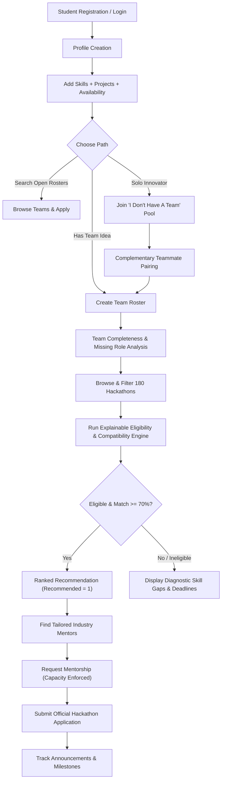
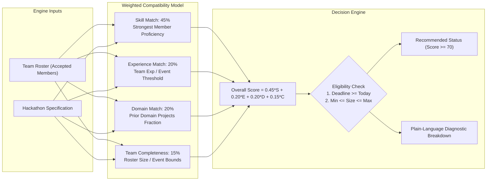
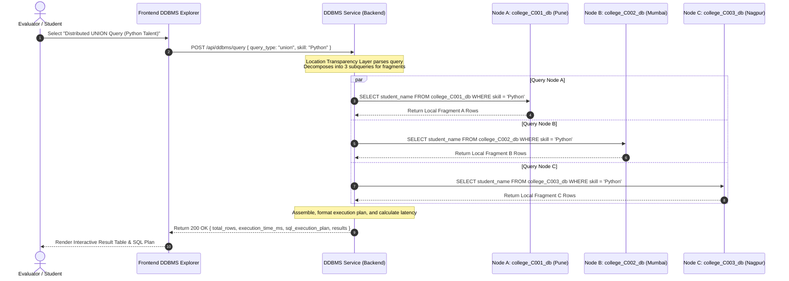

# HackBridge System Workflow & Architecture Diagrams

This document illustrates the end-to-end execution flows and architectural interactions across HackBridge.

---

## 1. End-to-End Student Hackathon Journey

---

## 2. Explainable Recommendation Engine Flow

---

## 3. DDBMS Distributed Query Decomposition

